  

<h1 align="center">Hi 👋, I'm Abishek</h1>

<h3 align="center">Full-Stack Developer | CSE Student | Microsoft Learn Student Ambassador</h3>

  

  Building reliable web systems with clean architecture and scalable solutions.

<h2 align="center">🚀 About Me</h2>

I'm **Abishek**, a Computer Science Engineering student at Muthayammal Engineering College, Rasipuram, and a Microsoft Learn Student Ambassador.

I build full-stack projects with the **MERN stack**, and I'm sharpening my problem-solving through **Data Structures & Algorithms**.

I also run **VoidFramez**, a content brand, and mentor juniors in Java.

My goal is simple: write clean code, build reliable software, and grow into an engineer who creates systems that last.

 

<h2 align="center">🤝 Connect</h2>

  
  &nbsp;&nbsp;&nbsp;
  
  &nbsp;&nbsp;&nbsp;
  

<h2 align="center">💻 Tech Stack</h2>

  

<h2 align="center">📊 GitHub Stats</h2>

  

<h2 align="center">📈 Activity Graph</h2>

  

<h2 align="center">⌘ Commit Activity</h2>

  <picture>
    <source media="(prefers-color-scheme: dark)" srcset="https://raw.githubusercontent.com/Abishek07-tech/Abishek07-tech/output/pacman-contribution-graph-dark.svg">
    <source media="(prefers-color-scheme: light)" srcset="https://raw.githubusercontent.com/Abishek07-tech/Abishek07-tech/output/pacman-contribution-graph.svg">
    
  </picture>

<<h2 align="center">⌘ Philosophy</h2>

  <i>"If you miss an opportunity, don't fill the eyes with tears. It will hide another better opportunity in front of you"</i>
    
  <b>- CM Vijay anna </b>

